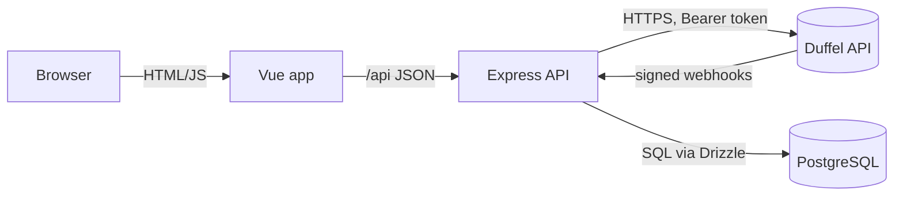

# Architecture

## Overview



- The **frontend** is a single-page Vue app. It never talks to Duffel directly and never sees the Duffel token.
- The **backend** validates every request, talks to Duffel, and stores bookings.
- **PostgreSQL** stores only completed or in-progress bookings, their passengers, and processed webhook events.

How the pieces are hosted:

| Environment | Web app | API | Database |
|---|---|---|---|
| Local npm | Vite dev server `:5173` | `tsx watch` `:5000` | Docker `postgres` `:5432` |
| Local Docker | nginx container `:8080` (proxies `/api`) | `backend` container | `postgres` container |
| Render | served by the API container (same origin) | Docker web service | Render PostgreSQL |

## Repository layout

```
.
├── backend/                     Express API (TypeScript)
│   ├── src/
│   │   ├── app.ts               Builds the Express app (dependencies injected)
│   │   ├── server.ts            Process entry: wires real services, starts listening
│   │   ├── config/env.ts        Environment validation + test/live safety checks
│   │   ├── db/
│   │   │   ├── schema/          Drizzle table definitions
│   │   │   ├── migrations/      Generated SQL migrations
│   │   │   ├── index.ts         Connection pool
│   │   │   └── migrate.ts       Runtime migrator (used on container start)
│   │   ├── integrations/duffel/ Everything that knows about Duffel
│   │   ├── middleware/          Errors, rate limits, provider-configured check
│   │   ├── modules/
│   │   │   ├── flights/         Airports, search, offers
│   │   │   ├── bookings/        Create + look up bookings
│   │   │   └── webhooks/        Duffel webhooks
│   │   ├── types/               Provider-agnostic types
│   │   └── utils/               Errors, HTTP helpers, crypto, dates, logger
│   ├── tests/                   Vitest + supertest
│   └── drizzle.config.ts
├── frontend/                    Vue 3 app (TypeScript)
│   ├── src/
│   │   ├── views/               One component per page
│   │   ├── components/          common/, flights/, booking/
│   │   ├── composables/         Shared state and reusable logic
│   │   ├── services/            Axios API client
│   │   ├── utils/               Formatting, filtering, validation
│   │   ├── router/ types/
│   │   └── App.vue, main.ts
│   ├── Dockerfile, nginx.conf   Web app container (docker compose)
│   └── docker-entrypoint.sh     Prints the app URL on start
├── docs/                        This documentation
├── Dockerfile                   API image (target `api`) / all-in-one image (default, Render)
├── docker-compose.yml           postgres + backend + frontend
├── render.yaml                  Render Blueprint
└── package.json                 npm workspaces and shortcuts
```

## Backend layers

Each module follows the same flow:

```
route  ──▶  controller  ──▶  service  ──▶  repository (PostgreSQL)
(URL,       (validate with    (business      └─▶  provider (Duffel)
 limits)     Zod, send JSON)   logic)
```

| Layer | Responsibility | Example |
|---|---|---|
| Routes | URL → handler, rate limiting, "provider configured?" check | `bookings.routes.ts` |
| Controllers | Parse and validate input (Zod), choose HTTP status, send the response | `bookings.controller.ts` |
| Services | Business rules: re-pricing, idempotency, state changes | `bookings.service.ts` |
| Repository | All SQL, parameterised by Drizzle, transactions | `bookings.repository.ts` |
| Provider | Talks to Duffel and maps its responses to app types | `integrations/duffel/` |

**Dependency injection.** `createApp()` receives its services, and each service receives its repository and provider.
`server.ts` wires the real ones; tests pass in-memory fakes. No framework, just function parameters.

**Provider abstraction.** `types/provider.ts` defines a `FlightProvider` interface (`searchPlaces`, `searchOffers`,
`listOffers`, `getOffer`, `createOrder`, `getOrder`). The Duffel implementation maps Duffel's JSON into the app's own
types (`types/flights.ts`, `types/booking.ts`). Replacing Duffel means writing another implementation of that interface.

**Errors.** Code throws `AppError(status, code, message, details)`. One error middleware turns errors into
`{ success: false, error: { code, message, details } }`. Unknown errors become a generic 500 and are logged without
request bodies. Successful responses are always `{ success: true, data }`.

## Frontend structure

- **Pages** (`views/`) fetch data and hold page state.
- **Components** are presentational and reused (e.g. `SliceTimeline` is used on details, confirmation and lookup).
- **Composables**: `useBookingDraft` (selected offer, passengers, idempotency key, kept in memory),
  `useAirportSearch` (debounced autocomplete), `useLastBooking` (confirmation after redirect).
- **Search parameters live in the URL**, so results can be refreshed and shared.

Details in [Frontend](frontend.md).

## Key design decisions

| Decision | Why |
|---|---|
| Fetch the offer from Duffel again before showing details and before booking | Prices and availability change; the user must never book a stale price |
| Insert a `pending` booking before calling Duffel | If the process dies mid-order, the booking can still be reconciled |
| Client-generated idempotency key per checkout | Double clicks, retries and refreshes can't create two orders |
| Hashed, random lookup tokens instead of IDs or email lookup | Bookings can't be guessed or enumerated |
| Lookup via `POST` body, private links via URL fragment (`#code=`) | The secret never appears in server logs |
| Re-fetch orders on webhooks instead of trusting the payload | Duffel stays the source of truth; replays are harmless |
| One container on Render, separate nginx container locally | Cheapest on Render; clearer separation locally |
