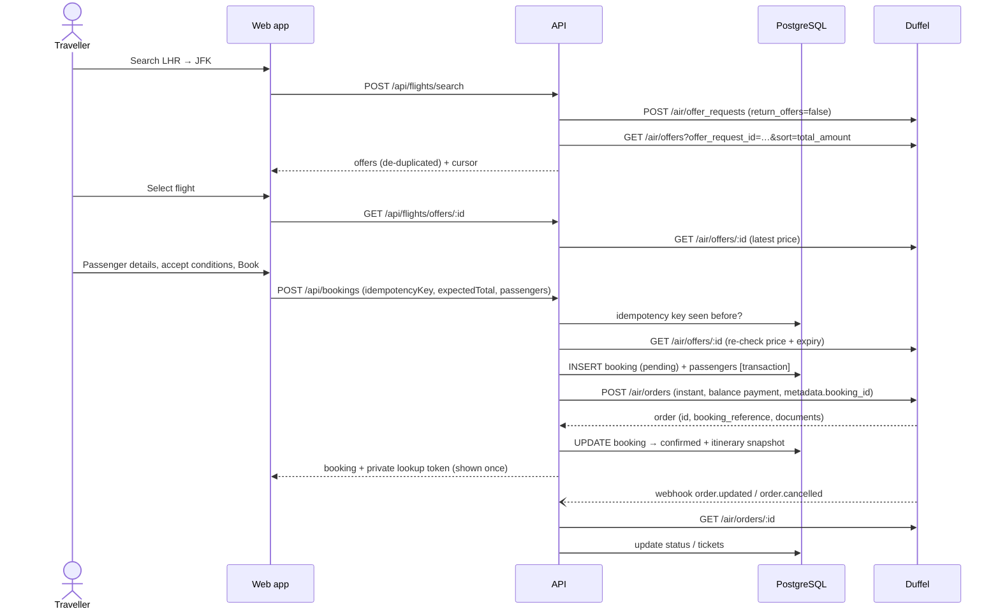

# Booking flow

This page follows one booking from search to confirmation, including what happens when something goes wrong.

## Sequence

## Steps in detail

### 1. Search

- The form validates airports (must be chosen from autocomplete), dates (not in the past, return ≥ departure, within
  about a year), passenger counts (1–9 total, at least 1 adult, each infant needs an adult) and cabin class.
- Children's and infants' **ages** are collected because Duffel prices passengers under 18 by age.
- The backend creates a Duffel offer request and returns the first 50 offers sorted by price. **Load more flights**
  fetches the next page with Duffel's cursor.
- Offers that are identical for the traveller (same airline, flights, times, cabin, baggage, fare brand, conditions and
  price) are removed. Offers that differ in any of these are kept.
- Sorting (cheapest, fastest, earliest) and filters (stops, maximum price, airlines) run in the browser over the
  loaded offers.

### 2. Flight details

The offer is fetched **again** from Duffel. If the price differs from the one shown in the results, a banner shows old
and new prices. A countdown shows when the offer expires. Expired or unavailable offers show a clear message with a link
to search again.

### 3. Passenger details

One form per passenger on the offer. Fields: title, gender, given name, family name, date of birth, plus passport
number, issuing country and expiry **only when the airline requires them**. One contact email and phone (international
format) are used for all passengers.

Validation, both in the browser and on the server:

- Names: letters, spaces, hyphens, apostrophes.
- Date of birth must give the same age on the departure date as the age used at search time. Adults must be 18+.
  Lap infants must be under 2 for the whole trip.
- Passport (when required) must be valid after the last flight.

Passenger data stays in the browser tab's memory only — it is not written to local storage.

### 4. Checkout

The page re-fetches the offer once more. If the price changed, the user must tick the confirmation box again for the
new total. **Book now** stays disabled until conditions are accepted, and is disabled while the request runs. Leaving the
page during booking asks for confirmation.

### 5. Order creation (server)

`POST /api/bookings` does the following, in order:

1. Refuse if bookings are disabled (live mode without `DUFFEL_LIVE_BOOKINGS_ENABLED=true`).
2. **Idempotency.** If a booking with this `idempotencyKey` exists, return it (with a freshly issued lookup token)
   instead of creating another order.
3. **Re-price.** Fetch the offer. Expired → `410 OFFER_EXPIRED`. Different total or currency than `expectedTotal` →
   `409 PRICE_CHANGED` with the new total in `details`.
4. **Validate passengers** against the offer (see above). Problems → `422 INVALID_PASSENGERS` with a list.
5. **Insert** the booking as `pending` with its passengers in one transaction, storing the SHA-256 hash of a new
   random lookup token.
6. **Create the Duffel order**: type `instant`, payment type `balance` for the exact offer total, and
   `metadata.booking_id` set to our booking id.
7. On success, store the order id, airline booking reference, ticket numbers, payment status and an itinerary
   snapshot. Status becomes `confirmed`. Respond `201`.

### 6. Confirmation

Shows the airline booking reference, Duffel order id, statuses, itinerary, passengers, total and the **private booking
code** with copy buttons for the code and a private link (`/booking/lookup#code=…`). The code is shown only once.

### 7. Lookup

`POST /api/bookings/lookup { token }` hashes the token and finds the booking. If the booking has a Duffel order and
was last updated more than a minute ago, the latest order is fetched from Duffel so cancellations and newly issued
tickets show up.

## Statuses

| Field | Values | Meaning |
|---|---|---|
| `status` | `pending` | Booking row exists; Duffel order not confirmed (yet). Also used when the outcome is unknown. |
| | `confirmed` | Duffel created the airline order. Always has a `provider_order_id` (enforced by a database constraint). |
| | `failed` | Duffel definitively rejected the order. No airline booking exists. |
| | `cancelled` | The order was cancelled after confirmation. |
| `ticketing_status` | `not_issued` / `issued` | A confirmed reservation is not necessarily ticketed. `issued` once Duffel returns e-ticket documents. |
| `payment_status` | `pending`, `paid`, `awaiting_payment`, `failed`, `refunded` | Payment state reported for the order. |

The UI shows these as separate badges, e.g. *Reservation confirmed* + *Tickets not yet issued* + *Test booking*.

## When things go wrong

| Situation | What the user sees | What the server does |
|---|---|---|
| Offer expired before booking | "This offer has expired" + search again | Nothing stored |
| Price changed | Old vs new price, must accept again | Nothing stored; a new attempt key is used |
| Invalid passenger details | List of problems | Nothing stored |
| Payment/order rejected by Duffel | Error message | Booking marked `failed` with the reason |
| Duffel timeout / network error / 5xx | "Booking is being confirmed — do not book again" | Booking stays `pending` (`OUTCOME_UNKNOWN`); the `order.created` webhook links it via `metadata.booking_id` |
| User double-clicks or retries after a lost connection | Same booking returned | Same idempotency key → no second order |
| Database restarts | Requests may fail briefly | API keeps running and reconnects automatically |
